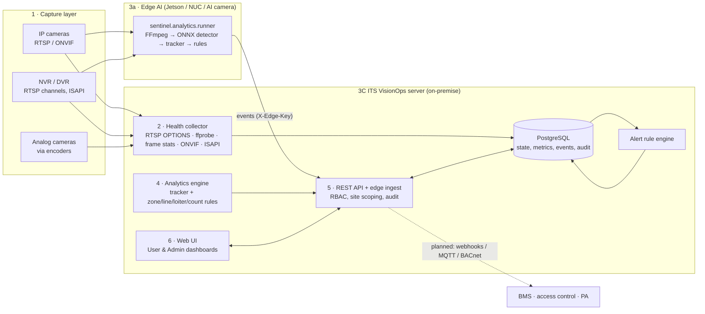

# Architecture

## Components

| Layer | Code | Responsibility |
|---|---|---|
| Capture / onboarding | `sentinel/onboarding.py` | WS-Discovery probe, CSV import (validated, all-or-nothing), RTSP URL templates for NVR channels |
| Ingestion / probes | `sentinel/health/probes.py` | RTSP OPTIONS, ffprobe measurement of FPS/bitrate/codec, 160×90 grayscale frame grab, image statistics, ONVIF SOAP calls with WS-UsernameToken |
| Health drivers | `sentinel/health/drivers.py` | Turn a device record into a reading; `generic`, `rtsp`, `tcp`, `hikvision_isapi`, `simulator`. Register new vendor drivers here |
| Collector | `sentinel/health/collector.py` | Polls every enabled device in parallel (32 threads), stores the latest state and a time series, and runs the alert engine |
| Alert engine | `sentinel/health/alerts.py` | Rules of the form "metric op threshold for duration". Opens alerts and resolves them automatically; skips metrics a device doesn't report |
| Analytics | `sentinel/analytics/engine.py` | Detector-agnostic IoU tracker plus rule plugins, with false-alarm filters (class, confidence, box size, track age) |
| Detector | `sentinel/analytics/detectors.py` | Detector interface, plus an optional ONNX YOLO adapter |
| Edge worker | `sentinel/analytics/runner.py` | Same code runs on the edge or on the server (the hybrid model) and posts events to `/api/edge/events` |
| API | `sentinel/api/*` | FastAPI with JWT (HttpOnly cookie or Bearer token), 5 roles, per-site scoping (out-of-scope devices return 404), audit log |
| UI | `sentinel/static/*` | Dependency-free ES module single-page app with inline SVG charts, light and dark themes, phone layout |

## Data model

- `sites`. Users are linked to sites through `user_sites`.
- `nvrs` and `cameras`. A camera can be linked to an NVR channel. Building, floor and zone are stored on each camera.
- `device_state`: the latest reading per device. The `data` JSON holds only keys the device actually reported.
- `health_metrics`: a numeric time series per device. True/false flags are stored as 0/1, and derived values `fps_ratio` and `abs_time_drift_s` are included.
- `alert_rules`, `rule_breaches` and `alerts`.
- `events`: AI events with their review status (new / acknowledged / true_alarm / false_alarm).
- `edge_devices`: API keys are stored as bcrypt hashes and found by key prefix.
- `audit_log`.

## Scale notes

- The collector runs probes in parallel with 32 threads. A `generic` check costs about 3–5 s per camera (ffprobe reads 3 s of video), so about 500 cameras fit in a 60 s interval. For larger fleets:
  - use the `rtsp` driver for routine checks, or
  - run more collector workers, one per site group (planned).
- `health_metrics` grows by roughly 15 rows per camera per check. With PostgreSQL, add TimescaleDB or partitioning above about 1,000 cameras. Retention pruning is built in (`SC_METRIC_RETENTION_DAYS`).
